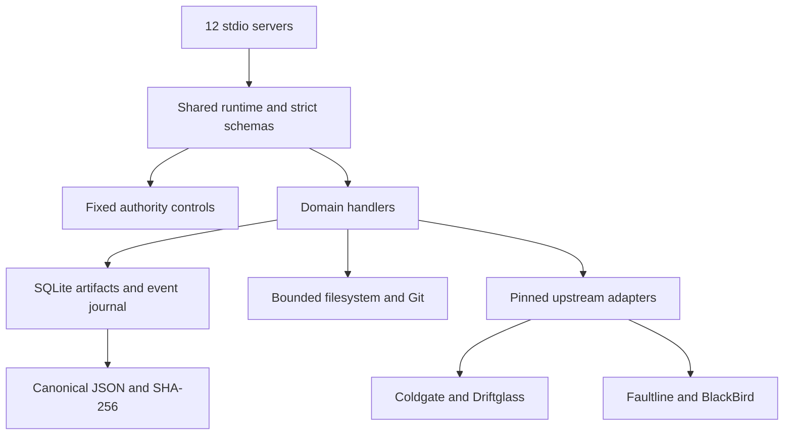

# Architecture decision — 2026-09-29

## Monorepo and runtime

The task workspace was empty and was not a repository. Existing projects had different product boundaries and runtimes, and none was already a suite host. A new **monorepo with local-first operation** therefore coordinates the adapters while leaving existing repositories intact. The owner subsequently created [mcpservers](https://github.com/canadianbaconking-collab/mcpservers) and authorized source publication there. No repository was recreated.

Node 24 is available locally and supports native SQLite and Coldgate's erasable TypeScript. The official MCP TypeScript SDK **v2.2.0** provides the protocol and stdio transport; it is used from JavaScript ESM. Zod **4.3.6** is the runtime validation source. Native `node:test` tests actual behavior and official client/server transport. pnpm **11.19.0** workspaces and a lockfile pin dependencies; install scripts are disabled. No handwritten MCP framing, Python package installation or TypeScript build is required.

Sources: [official SDK v2](https://ts.sdk.modelcontextprotocol.io/v2/), [stdio guide](https://ts.sdk.modelcontextprotocol.io/v2/serving/stdio), [first server](https://ts.sdk.modelcontextprotocol.io/v2/get-started/first-server). Registry availability and the installed package exports were checked during implementation.

## Layout

| Path | Role |
| --- | --- |
| `servers/<kebab-case-id>/tools.mjs` | Small domain tool definitions: schema, fixed effect, handler |
| `packages/schemas` | Strict validators, config and result envelope |
| `packages/provenance` | Stable canonical JSON and SHA-256 artifact identity |
| `packages/errors` | Stable domain error codes; sanitized unexpected errors |
| `packages/authority` | Fixed metadata and configuration enforcement |
| `packages/store` | SQLite immutable artifacts and serialized event transitions |
| `packages/runtime` | MCP registration, dispatch, bounded files and Git adapters |
| `packages/adapters` | Fixed Python bridges into Faultline and BlackBird |
| `packages/test-fixtures` | Isolated, explicitly synthetic Git/store fixtures |
| `vendor` | Pinned upstream source, checked by a content manifest |
| `docs/upstream` | Readme snapshots retained as audit context, not live instructions |

Workspace packages are private internal source packages. Tool names use `<server_id_with_underscores>_<verb>`, avoiding collisions across clients. Artifact kinds use kebab-case. Suite schemas use `schemaVersion: 1`; upstream fields and versions remain unchanged inside adapter results. Do not silently coerce upstream versions into suite semantics.

## Dependency direction

No server depends on another server process being up. Clients compose exact artifact IDs through the shared store. State transitions use `BEGIN IMMEDIATE` across connections. Network credentials are unnecessary for normal operation. Configured commands may themselves access a network; registering one is an operator responsibility.

## Persistence and lifecycle

Artifacts store `{id, kind, data}` with the ID derived from the kind, version and canonical data. Identical artifacts reuse their ID. Update/delete triggers prevent accidental history mutation. Events bind stream, sequence, previous hash and payload, and reads verify the chain. Database schema version 1 is explicit; newer versions fail startup rather than receiving a destructive migration.

Limits: input and artifacts 2 MB; project state 100 KB; action content 100 KB; event streams 10,000 events; bounded Git/child output 2 MB; BlackBird bundles 2,000 entries, depth 12, per-file 16 MB and aggregate 32 MB. Evidence inspection currently supports at most 10,000 observations. Errors or omissions cannot count as successful checks.

Close all server processes before copying the SQLite database, or use SQLite's backup tooling. A running WAL database is not safely backed up by copying only its main file. Export/restore tooling, retention, encryption and schema migrations are future work.

## Authority boundary

The trusted operator supplies config at startup. Tool callers can reference only configured repository aliases and registered check names. Path components reject traversal, Windows devices, alternate data streams and symbolic links/junctions. Static Coldgate reports and caller-supplied Driftglass policies remain advisory. They cannot change `allowFileWrites`, register commands or confer host approval.

The transport is local stdio, authenticated by process ownership; no remote bearer/OAuth claim is made. Resource contents, repository subjects, decision text and review packets are data, never policy. Realpath and precondition checks defend normal mistakes and cooperating processes, not a hostile concurrent filesystem owner. Registered checks and trusted local Git are not sandboxed. Windows timeouts may leave descendants alive; checks that spawn persistent services are unsuitable.
